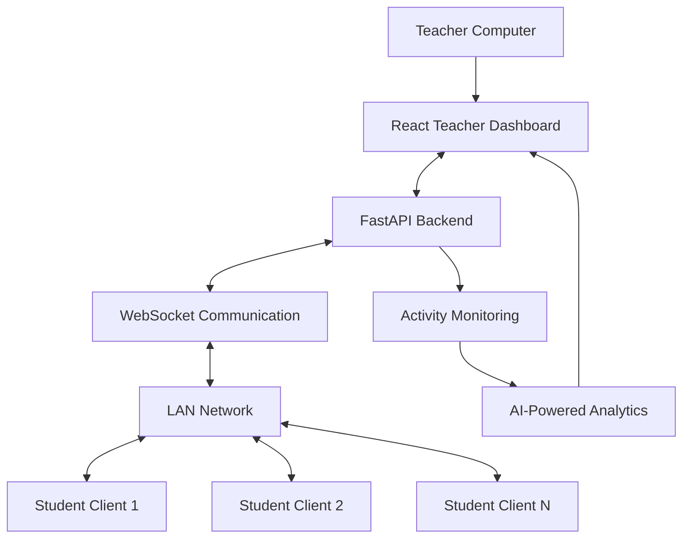

# 🖥️ LabSphere – Smart Lab Management System

**A LAN-Based Smart Laboratory Management and Monitoring System**

LabSphere is a centralized smart lab management system designed to simplify classroom administration, enable real-time student computer monitoring, and improve coordination between teachers and students within a computer laboratory.

The system operates over a Local Area Network (LAN), connecting a teacher's computer with multiple student computers. It provides centralized monitoring, screen broadcasting, remote control, file sharing, communication, and AI-powered lab activity analytics.

---

## 🎯 Problem Statement

Managing computer laboratories with multiple student systems can be challenging for teachers. Traditional lab environments often lack centralized monitoring, efficient communication, and tools to track student activities.

LabSphere addresses these challenges by providing a unified platform that enables teachers to monitor and manage connected student systems, communicate instructions, distribute resources, and gain insights into laboratory activities.

## ✨ Key Features

### 👨‍🏫 Teacher Dashboard
- Centralized dashboard for managing connected student computers.
- Real-time monitoring of student systems.
- View student screens and monitor computer activities.
- Manage laboratory sessions from a single interface.

### 🖥️ Student Computer Management
- Monitor connected student systems over the LAN.
- Remote lock and unlock functionality.
- Application and internet usage monitoring.
- Track active sessions and system activity.

### 📡 Screen Broadcasting
- Broadcast the teacher's screen to connected student computers.
- Enable synchronized demonstrations and instructions.
- Facilitate practical sessions and guided learning.

### 📁 File Sharing & Communication
- Share learning materials and resources with students.
- Send announcements and instructions.
- Enable teacher-student messaging.
- Improve communication during laboratory sessions.

### 🤖 AI-Powered Activity Analytics
- Analyze student computer activity during lab sessions.
- Generate insights from application usage, website activity, coding activity, idle time, and submissions.
- Provide activity summaries and reports to support better lab management.

## 🏗️ System Architecture

LabSphere follows a client-server architecture operating over a Local Area Network.



**Architecture Components:**

- **Teacher Dashboard:** Provides the interface for monitoring and managing student systems.
- **Backend Server:** Handles application logic, communication, and management operations.
- **WebSocket Communication:** Supports real-time communication between connected components.
- **Student Client:** Runs on student computers and handles monitoring and remote management operations.
- **AI Analytics:** Processes collected activity information to generate meaningful reports.

## 🛠️ Technology Stack

| Category | Technologies |
|---|---|
| Frontend | React.js, JavaScript, Vite |
| Backend | Python, FastAPI |
| Communication | WebSockets, Socket Programming |
| System Monitoring | Python, psutil |
| Desktop Integration | Python, Windows API |
| Development Tools | Git, GitHub, VS Code |

## 📂 Project Structure

```text
LabSphere/
│
├── backend/
│   └── Server-side application
│
├── student-client/
│   └── Student computer client
│
├── teacher-dashboard/
│   └── React-based teacher interface
│
└── README.md
```

*The directory structure above is illustrative. Update it to match the actual repository structure.*

## ⚙️ Installation & Setup

### Prerequisites

- Python 3.10 or later
- Node.js and npm
- Git
- Windows-based student computers
- A shared Local Area Network (LAN)

### 1. Clone the Repository

```bash
git clone https://github.com/YOUR-USERNAME/LabSphere.git
cd LabSphere
```

### 2. Backend Setup

```bash
cd backend
python -m venv venv
```

Activate the virtual environment:

**Windows:**
```bash
venv\Scripts\activate
```

Install the dependencies:

```bash
pip install -r requirements.txt
```

Start the backend using the actual entry-point configured in your project. For example:

```bash
uvicorn main:app --host 0.0.0.0 --port 8000
```

### 3. Teacher Dashboard Setup

```bash
cd teacher-dashboard
npm install
npm run dev
```

### 4. Student Client Setup

Navigate to the student-client directory, install its required Python dependencies, configure the teacher server's LAN IP address, and run the student client.

**Note:** Update the commands and configuration according to the actual project files before using this guide.

## 🌐 Network Configuration

LabSphere is designed to operate within a shared Local Area Network.

- The teacher computer hosts the backend server.
- Student computers connect to the teacher computer using its LAN IP address.
- Required ports must be allowed through the firewall.
- All connected systems should be reachable over the same network.

## 🔮 Future Enhancements

- Advanced AI-based student activity insights.
- Detailed laboratory performance reports.
- Enhanced analytics and visualization.
- Improved security and authentication.
- Support for additional operating systems.
- Automated session management and reporting.

## 👩‍💻 Contributors

Developed as an academic project with the goal of making computer laboratory management more efficient through centralized control, real-time communication, and intelligent activity monitoring.

## 📄 License

This project is developed for academic and educational purposes. Licensing and reuse permissions can be specified here.

---

⭐ **If you find LabSphere interesting, consider giving this repository a star!**